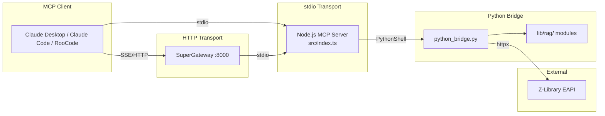

# Book Download MCP

[](https://github.com/gjjisadog/book-download-mcp/actions/workflows/ci.yml)
[](https://github.com/gjjisadog/book-download-mcp/blob/main/LICENSE)

Book Download MCP is an independent development project based on
[rookslog/zlibrary-mcp v1.4.0](https://github.com/rookslog/zlibrary-mcp/tree/v1.4.0)
and adds a configurable account pool with automatic failover on rejected login
or exhausted download quota. The upstream history and MIT license are preserved.
Install from this repository to use these additions; the upstream npm package
and published container images do not include this repository's changes.

A Model Context Protocol (MCP) server that gives AI assistants -- Claude Code, Claude Desktop, RooCode, Cline -- the ability to search Z-Library, download books, and extract document content for Retrieval-Augmented Generation (RAG) workflows. Built with a Node.js/TypeScript MCP frontend and a Python bridge backend for document processing.

For what this project is — and deliberately isn't — see [VISION.md](VISION.md).

## Quick Start

**Prerequisites:** Node.js 22+, Python 3.10+, and [UV](https://docs.astral.sh/uv/)
(`curl -LsSf https://astral.sh/uv/install.sh | sh`)

```bash
git clone https://github.com/gjjisadog/book-download-mcp.git
cd book-download-mcp
bash setup-uv.sh
npm ci
npm run build
```

Then add to your MCP client config (Claude Code `.mcp.json`, Claude Desktop `claude_desktop_config.json`):

```json
{
  "mcpServers": {
    "bookharbor": {
      "command": "node",
      "args": ["/absolute/path/to/book-download-mcp/dist/index.js"],
      "env": {
        "ZLIBRARY_ACCOUNTS": "[{\"email\":\"first@example.com\",\"password\":\"first_password\"},{\"email\":\"second@example.com\",\"password\":\"second_password\"}]"
      }
    }
  }
}
```

Developing or contributing? Install [from source](#option-b-from-source-for-development) instead.

## Architecture Overview



- **Node.js/TypeScript MCP Server**: 13 tools registered via McpServer `server.tool()` API (MCP SDK 1.25+)
- **Python Bridge**: Z-Library EAPI client (httpx) + document processing (lib/rag/ modules)
- **EAPI Transport**: JSON API endpoints at `/eapi/` bypass Cloudflare browser challenges
- **UV-Based Python Environment**: Project-local `.venv/` with `uv.lock` for reproducible builds
- **Vendored Z-Library Fork**: Custom EAPI client for search and file downloads
- **RAG Pipeline**: EPUB/PDF/TXT extraction with quality detection, output to files (not memory)

## Available MCP Tools (13 Total)

### Search Tools (7)

| Tool | Description |
|------|-------------|
| `search_books` | Basic search by keyword with filters |
| `full_text_search` | Search within book contents |
| `search_by_term` | Conceptual navigation via terms |
| `search_by_author` | Advanced author search |
| `search_advanced` | Fuzzy match detection with separate exact/fuzzy results |
| `search_multi_source` | Parallel search across multiple sources |
| `get_recent_books` | Recently added books |

### Metadata Tools (1)

| Tool | Description |
|------|-------------|
| `get_book_metadata` | Complete metadata extraction (terms, descriptions, ratings) |

### Collection Tools (1)

| Tool | Description |
|------|-------------|
| `fetch_booklist` | Expert-curated collection contents |

### Download & Processing Tools (2)

| Tool | Description |
|------|-------------|
| `download_book_to_file` | Download with optional file-based RAG bundle output |
| `process_document_for_rag` | Extract a file-based RAG bundle from EPUB/PDF/TXT |

### Utility Tools (2)

| Tool | Description |
|------|-------------|
| `get_download_limits` | Check daily download quota |
| `get_download_history` | View recent downloads |

For complete parameter documentation, types, and examples, see [API Reference](docs/api.md).

### Comparing versions and confirming downloads

`search_multi_source` now defaults to `source="all"`: it searches LibGen and all
configured sources (Z-Library with account credentials, Anna's Archive with a key)
in parallel. A failed source is reported in `sources_unavailable` without hiding
healthy results. `source="auto"` keeps the previous Anna/LibGen fallback behavior;
`zlibrary`, `annas`, `libgen`, `libgen_mcp`, and `find_a_book` select a specific source/backend.

Two optional MCP backends are installed by a normal `npm install` / `npm ci`:

| Source value | Upstream dependency | Integration |
|---|---|---|
| `libgen_mcp` | [jmrplens/libgen-mcp](https://github.com/jmrplens/libgen-mcp), `@jmrp.io/libgen-mcp@2.2.1` (MIT) | LibGen and open-access discovery; downloads identified by MD5, DOI or ISBN |
| `find_a_book` | [Xiaochengzi2048/find-a-book-mcp](https://github.com/Xiaochengzi2048/find-a-book-mcp), `find-a-book-mcp@1.7.1` (MIT) | LibGen search and MD5 downloads using its mirror implementation |

These are separate access implementations with overlapping LibGen catalogs, not
two new independent libraries. Results retain both the backend `source` and the
catalog/provider `origin`. `source="all"` includes installed backends automatically.
To select which optional backends participate, set
`BOOKHARBOR_MCP_SOURCES=libgen_mcp,find_a_book`; an empty value disables both.
If optional packages were omitted, restore them with `npm install --include=optional`.
The existing Python LibGen adapter remains available without these packages.

The adapters use the upstream MCP interfaces without copying their code. They
forward no Z-Library account credentials, account pools or Anna's keys; Z-Library
authentication stays in Book Download MCP. Network proxy settings (`HTTP_PROXY`,
`HTTPS_PROXY`, `ALL_PROXY`, `NO_PROXY`, including lowercase forms) are forwarded
when present in Book Download MCP's environment; clients on restricted networks must
inherit or explicitly configure those settings. Each request has a deadline and a private
working directory. Downloads are staged there, validated (including MD5 when
available), then published without overwriting existing files. The optional
backend download limit is 512 MiB per file. RAG processing uses the same local
pipeline after a successful download.

Open-access hits without a supported MD5/DOI/ISBN are returned separately under
`discovery` as `metadata_only: true`, preserving their reference links without
claiming they are downloadable. `find_a_book` returns its first search page (up
to five hits); `count` is an upper bound, not a guaranteed number of matches.

Results prioritize comparable reported quality scores, then reader ratings.
Different sources' scores are compared only when their maximum scales are supplied;
otherwise only scores from a common source are comparable. Missing ratings remain
unknown. These scores are source metadata, not a measured resolution or an
inspection of the file. File size and format alone do not prove clarity. Always
check title, author, language, and edition before treating results as alternatives.

Pass the chosen `bookDetails` and up to 19 matching `alternatives` to
`download_book_to_file`. Clients advertising MCP form elicitation show a version
selection dialog with source, format, size, language, year, and available scores.
The user can choose any version or cancel; cancellation never starts a download.
Without form support, the tool returns `status="confirmation_required"` and ranked
candidates. Ask the user in conversation, then call again with their exact chosen
`bookDetails` and `confirmed=true`. Never set this flag without user confirmation.
This confirmation also applies to single-book downloads. Existing automated callers
must obtain approval before setting `confirmed=true`.

The two existing tools keep their names; no additional MCP tools are required.

## Installation

### Option A: Independent npm package (after first publication)

The independent package identity is `@gjjisadog/zlibrary-mcp`, version `1.4.1`.
Until its first npm release is available, use the source installation below.

**Prerequisites:** Node.js 22+, Python 3.10+, [UV](https://docs.astral.sh/uv/)

```bash
npm install -g @gjjisadog/zlibrary-mcp
cd "$(npm root -g)/@gjjisadog/zlibrary-mcp"
bash setup-uv.sh
```

The repository and display name are Book Download MCP; the npm package and CLI command remain `@gjjisadog/zlibrary-mcp` and `zlibrary-mcp`. This package includes the Python bridge,
vendor library and locked dependencies. Release setup is described in
[Publishing](docs/publishing.md).

### Option B: From Source (for development)

**Prerequisites:** Node.js 22+, Python 3.10+, [UV](https://docs.astral.sh/uv/)

```bash
# 1. Install UV (one-time, if not already installed)
curl -LsSf https://astral.sh/uv/install.sh | sh

# 2. Clone and build
git clone https://github.com/gjjisadog/book-download-mcp.git
cd book-download-mcp
git lfs pull         # Hydrates LFS-tracked test PDFs (don't run `git lfs install`;
                     # it conflicts with the repo's Husky-managed hooks)
bash setup-uv.sh    # Creates .venv/ and installs Python dependencies
npm install          # Installs Node.js dependencies
npm run build        # Compiles TypeScript to dist/
```

**MCP client configuration (stdio transport):**

Claude Code (`.mcp.json` in your project root):

```json
{
  "mcpServers": {
    "bookharbor": {
      "command": "node",
      "args": ["/absolute/path/to/book-download-mcp/dist/index.js"],
      "env": {
        "ZLIBRARY_EMAIL": "your-email@example.com",
        "ZLIBRARY_PASSWORD": "your-password"
      }
    }
  }
}
```

RooCode / Cline (`mcp_settings.json`):

```json
{
  "mcpServers": {
    "zlibrary-local": {
      "command": "node",
      "args": ["/absolute/path/to/book-download-mcp/dist/index.js"],
      "env": {
        "ZLIBRARY_EMAIL": "your-email@example.com",
        "ZLIBRARY_PASSWORD": "your-password"
      },
      "transport": "stdio",
      "enabled": true
    }
  }
}
```

### Option C: Docker (HTTP transport)

**Prerequisites:** Docker

Upstream images are published to GHCR on every upstream release (`latest`, `1.3`,
`1.3.2`, …) — no clone or build needed:

```bash
docker run -d --name zlibrary-mcp -p 127.0.0.1:8000:8000 \
  -e ZLIBRARY_EMAIL="your-email@example.com" \
  -e ZLIBRARY_PASSWORD="your-password" \
  -v "$PWD/downloads:/app/downloads" \
  ghcr.io/rookslog/zlibrary-mcp:latest
```

The image wraps the stdio server in
[SuperGateway](https://github.com/supercorp-ai/supergateway), exposing MCP over
SSE at `http://localhost:8000/sse`. Verify it's serving:

```bash
curl -s -N --max-time 3 http://localhost:8000/sse | head -2
# event: endpoint
# data: /message?sessionId=...
```

> Alpine caveat: OpenCV has no musl wheels, so X-mark detection is unavailable
> in the container; everything else works.

**Build this repository from source to include account-pool support**
(adds a `/health` endpoint via compose):

```bash
git clone https://github.com/gjjisadog/book-download-mcp.git && cd book-download-mcp
cp docker/env.example docker/.env   # then edit in your credentials
docker compose -f docker/docker-compose.yaml up -d
curl http://localhost:8000/health
```

**MCP client configuration (SSE/HTTP transport):**

```json
{
  "mcpServers": {
    "bookharbor": {
      "command": "npx",
      "args": ["-y", "supergateway", "--sse", "http://localhost:8000/sse"]
    }
  }
}
```

## Output Format (RAG Processing)

The RAG pipeline processes downloaded documents (EPUB, PDF, TXT) into clean text files for use in retrieval-augmented generation workflows.

- **Output location:** Processed text files are saved to `./processed_rag_output/`
- **File-based output:** Tools return file paths rather than raw text content, avoiding context overflow in AI assistants
- **Bundle contract:** `processed_file_path` remains the body-text anchor, with additive sibling fields like `metadata_file_path`, optional `footnotes_file_path`, and an `output_files` map when available
- **Supported formats:** EPUB, PDF, and TXT
- **Quality detection:** The pipeline automatically detects document quality (OCR vs. digital text) and applies appropriate extraction strategies
- **Scholarly formatting:** Preserves footnotes, chapter structure, and academic formatting where possible

Use `download_book_to_file` with `process_for_rag: true` for combined download and processing, or `process_document_for_rag` to process an existing file.

## Configuration

Each Node service reuses authenticated account sessions in memory for up to ten minutes.
A lightweight profile request validates a cached session; expiry or rejection triggers
login again. Password or pinned-domain changes invalidate the cache. Restarting the
service clears it. Session tokens are never stored in the account preference file or
returned to MCP clients. Python calls have a total deadline of 180 seconds, configurable
with `PYTHON_BRIDGE_TIMEOUT_MS`; request cancellation stops the worker process tree.

Z-Library tools use credentials supplied through your MCP client's environment.
Other sources and local document processing do not require Z-Library credentials.

| Variable | Required | Description |
|----------|----------|-------------|
| `ZLIBRARY_EMAIL` | For single-account mode | Z-Library account email |
| `ZLIBRARY_PASSWORD` | For single-account mode | Z-Library account password |
| `ZLIBRARY_ACCOUNTS` | For account-pool mode | JSON array of accounts; overrides the single-account variables |
| `ZLIBRARY_ACCOUNT_STATE_FILE` | No | Preference file; defaults to `.cache/zlibrary-account-pool.json` in the package directory |
| `ZLIBRARY_MIRROR` | No | Custom Z-Library mirror URL |

Malformed account-pool configuration fails validation at startup. Missing credentials
produce a warning; Z-Library tools fail when called, while other sources remain available.

### Account pool and automatic failover

Supply your own accounts in `ZLIBRARY_ACCOUNTS`, as a JSON string in your MCP
configuration's `env` object:

```json
{
  "ZLIBRARY_ACCOUNTS": "[{\"email\":\"first@example.com\",\"password\":\"first_password\"},{\"email\":\"second@example.com\",\"password\":\"second_password\"}]"
}
```

The pool starts with the first account and remembers the most recently usable
account across calls and restarts. A rejected login tries the next account. Before
a Z-Library download, the pool checks the account's remaining quota and skips
exhausted accounts. A quota rejection when obtaining a download link also tries
the next account, covering a quota change between the check and the download.
Each account is attempted at most once per call; if none is usable, the tool
returns an error with rejection and exhaustion counts.

Searches, download history, and quota queries use the selected account; quota
and history are for that account, not totals for the pool. An account with no
download quota can still serve searches. Network errors and anti-bot blocks use
the existing error handling rather than account switching. Without
`ZLIBRARY_ACCOUNTS`, the existing single-account behavior is preserved.

The state file contains only a pool fingerprint and the preferred account index;
passwords and login tokens are not saved there. Writes are atomic, so concurrent
calls cannot leave a partially written preference. Concurrent calls may use the
same account; the service enforces the actual download quota. If the package
directory is read-only, set `ZLIBRARY_ACCOUNT_STATE_FILE` to a writable location.
If state cannot be saved, failover still works within the current call, but the
next call starts selection again. Keep account credentials in your private MCP
configuration or environment. Accounts are not bundled with the source code.

### Logging

Diagnostics go to **stderr**, never stdout: under the stdio transport stdout is the
JSON-RPC channel, and anything else written there corrupts the protocol stream and
causes clients to disconnect. Your MCP client captures stderr into its own logs.

| Variable | Default | Description |
|----------|---------|-------------|
| `LOG_LEVEL` | `info` | `silent`, `error`, `warn`, `info`, or `debug` |

`debug` adds per-request argument tracing, which **includes your search queries**.
Scrub client logs before attaching them to a bug report.

### Diagnosing problems

```bash
npm run doctor
```

This probes Z-Library, Anna's Archive, and LibGen directly and reports which
respond. Those are undocumented third-party services that change domains without
notice, so an upstream outage and a bug in this server look identical from an MCP
client. Run this before filing an issue — and see
[TROUBLESHOOTING.md](docs/TROUBLESHOOTING.md) for the setup-related causes of a
server that exits immediately.

### Retry and Circuit Breaker

All API operations include automatic retry with exponential backoff and circuit breaker protection. These are configurable via environment variables:

| Variable | Default | Description |
|----------|---------|-------------|
| `RETRY_MAX_RETRIES` | `3` | Maximum retry attempts |
| `RETRY_INITIAL_DELAY` | `1000` | Initial retry delay (ms) |
| `RETRY_MAX_DELAY` | `30000` | Maximum retry delay (ms) |
| `RETRY_FACTOR` | `2` | Exponential backoff multiplier |
| `CIRCUIT_BREAKER_THRESHOLD` | `5` | Failures before opening circuit |
| `CIRCUIT_BREAKER_TIMEOUT` | `60000` | Time (ms) before retry after circuit opens |

See [docs/RETRY_CONFIGURATION.md](docs/RETRY_CONFIGURATION.md) for details.

## Development

### Running Tests

```bash
# Node.js tests (Jest only -- npm test does not run pytest)
npm test

# Python tests -- fast suite (the routine command)
uv run pytest -m "not slow and not integration and not performance"

# Python tests -- full corpus (requires LFS-hydrated test PDFs)
uv run pytest

# Specific Python test
uv run pytest __tests__/python/test_rag_processing.py
```

### Building

```bash
npm run build
```

## FAQ

### Why EAPI instead of HTML scraping?

Z-Library deployed Cloudflare browser challenges (Jan 2026) that block all HTML page requests from automated clients. The EAPI JSON endpoints at `/eapi/` are not subject to these challenges, providing reliable programmatic access. See `docs/adr/ADR-005-EAPI-Migration.md`.

### Why use `node` in .mcp.json instead of `uv`?

The MCP server is a Node.js application. UV is only used during setup (`uv sync`) to create `.venv/` and install Python dependencies. At runtime, Node.js runs the MCP server which calls `.venv/bin/python` internally.

```
Setup:  uv sync --> creates .venv/
Build:  npm run build --> compiles TypeScript to dist/
Runtime: node dist/index.js --> runs MCP server --> calls .venv/bin/python internally
```

### What if I move the project directory?

No problem. `.venv/` moves with the project (UV creates project-local environments).

## Contributing

Contributions are welcome! See [CONTRIBUTING.md](CONTRIBUTING.md) for setup instructions, code style, testing, and PR workflow.

## License

This project is licensed under the MIT License - see the LICENSE file for details.

## Disclaimer

This tool is provided for educational and research purposes only. Users are responsible for complying with all applicable laws and regulations regarding the downloading and use of copyrighted materials. Accessing Z-Library may be restricted in certain jurisdictions.
